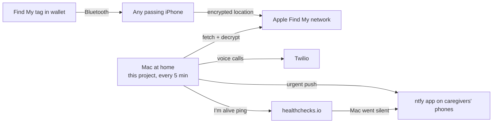

# Find My Wander Alert

Get a phone call and an urgent push notification when a parent with dementia
leaves their residence — using a ~$30 Apple Find My tag (a Ridge wallet tracker
card, an AirTag, …) that they already carry, and a Mac at home.

About 6 in 10 people living with dementia wander at some point. Paid GPS
trackers exist, but they need charging, a subscription, and a device the person
will actually keep with them. A tracker card in a wallet is none of that — but
Apple's Find My app can't tell you when a tag *leaves a place*. This project
adds that:

- **Away alert.** When the tag leaves a circle around the residence, every
  caregiver gets an urgent push notification with distance, direction, and a
  map link, repeated every 5 minutes, and each caregiver's phone rings once.
- **Front-desk call (optional).** A spoken message to the residence's front
  desk, repeated every 30 minutes until they're back.
- **Back home** notification when the tag returns.
- **It tells you when it's blind.** Caregivers are warned if Apple can't be
  reached for 30 minutes, if the tag hasn't reported for 4 hours (dead battery,
  or somewhere with no iPhones around), or — via a free external watchdog — if
  the Mac itself is off, asleep, or offline.



> [!WARNING]
> **Read this before relying on it.**
> - **It's a backstop, not a door alarm.** Find My is crowd-sourced over
>   Bluetooth: expect alerts **15–40 minutes after someone actually leaves**,
>   and longer where few iPhones pass by.
> - **It can stop working without notice.** It uses Apple's undocumented Find My
>   protocol through [FindMy.py](https://github.com/malmeloo/FindMy.py). Apple
>   changed its sign-in on 2026-10-12 and broke every unofficial client; this
>   project includes a workaround, and Apple can break it again. The health
>   warnings exist so you find out — but keep your other safety measures.
> - **It needs a Mac that's on 24/7**, logged in, awake, and online.
> - **Unofficial clients may put your Apple ID at risk** of extra security
>   checks or lockouts. Use at your own risk.
> - **Not a medical device or emergency service.** No warranty (see
>   [LICENSE](LICENSE)). In an emergency, call 911.

## Consent and Apple's anti-stalking protections

This is for families caring for someone who can't keep themselves safe, with
the involvement of the people responsible for their care. Talk to the residence
and the rest of the family about it. Don't use it to track anyone without their
(or their legal decision-maker's) consent.

The project only reads locations that the tag's owner can already see in Apple's
Find My app. It does **not** change Apple's protections against unwanted
tracking: a tag that is away from its owner can play a sound and notify an
iPhone it travels with ("Find My item found moving with you"). If your parent
carries an iPhone, sharing the item with their Apple ID in Find My stops those
alerts for them.

## What you need

- **A Mac** that can stay on and plugged in (a Mac mini is ideal). Tested on an
  Apple-silicon Mac with macOS 26 (Tahoe). The Apple sign-in uses the Mac's own
  device identity, so the Mac must be a real Mac — Linux, Windows, and cloud
  servers won't work.
- **Python 3.10+** (tested with 3.13).
- **A Find My tag** registered to your Apple ID: a Ridge Tracker Card (what this
  was built and tested with), an AirTag, or another "Works with Apple Find My"
  tag. Wallet cards are good because the wallet goes everywhere.
- **The tag's private key**, exported with
  [export-findmy](https://github.com/stek29/export-findmy) (needs the Rust
  toolchain). See step 1.
- **The free [ntfy](https://ntfy.sh) app** on every caregiver's phone.
- **Optional:** a [Twilio](https://www.twilio.com) account for phone calls (a
  phone number plus per-minute charges, typically a few dollars a month), and a
  free [healthchecks.io](https://healthchecks.io) account for the watchdog
  (strongly recommended).

## Setup

### 1. Export the tag's key

The Find My network only stores *encrypted* locations; you need the tag's
private key to read them. Follow the
[export-findmy README](https://github.com/stek29/export-findmy) (use the
`macos26` branch on macOS 26, and a Mac `[software]` preset in the device
profile). It writes a `.json` and `.plist` per Find My item into
`.local/keys/`.

Be aware of what this step does: export-findmy signs in as your Apple ID and
**joins your iCloud Keychain** as a new (synthetic) device to read the keys.
Afterwards:

1. Copy **only your tag's** `.json` into this project as `secrets/tag.json`
   (`mkdir -m 700 secrets`; `chmod 600 secrets/tag.json`). Delete the other
   exported key files you don't need — anyone with a key file can locate that
   item.
2. Remove the exporter from your keychain with
   `export-findmy --delete-own-escrow-bottle`, selecting **only** the record
   that matches the exporter's device profile (other records belong to your
   real devices).
3. Delete export-findmy's `.local/auth_cache.plist` and `keychain_state.plist`.

### 2. Install

```bash
git clone https://github.com/dan-shah/findmy-wander-alert.git
cd findmy-wander-alert
python3 -m venv .venv && .venv/bin/pip install -r requirements.txt
.venv/bin/pytest -q
```

### 3. Configure

```bash
cp .env.example .env && chmod 600 .env
```

Edit `.env`. Every setting is explained there; the important ones:

| Setting | What to put |
|---|---|
| `PARENT_NAME`, `RESIDENCE_NAME` | Used in alerts and calls ("Ashley left Maple Court"). |
| `RESIDENCE_LAT`, `RESIDENCE_LON` | The building. In Google Maps, right-click it and click the coordinates to copy them. |
| `GEOFENCE_RADIUS_METERS` | Start at 150. Locations from inside a building drift 30–200 m. |
| `CAREGIVER_PHONES` | Everyone to call, in `+15551234567` format, comma-separated. |
| `NTFY_TOPIC` | A long random name, e.g. the output of `python3 -c "import secrets; print('wander-' + secrets.token_urlsafe(18))"`. **Anyone who knows it can read the alerts**, so share it privately. |
| `TWILIO_*` | From the Twilio console (step 5). |
| `WATCHDOG_PING_URL` | From healthchecks.io (step 5). |
| `FRONT_DESK_*` | Leave `FRONT_DESK_CALL_ENABLED="false"` until you've talked to the front desk. If their number goes to a phone menu, put the keypresses in `FRONT_DESK_SEND_DIGITS` (`w` = half-second pause, e.g. `wwww0`). |

### 4. Sign in to Apple

Run this yourself in Terminal (it asks for your password and a 2FA code):

```bash
.venv/bin/python findmy_login.py you@example.com
```

Sign in with the Apple ID that owns the tag. It saves
`secrets/findmy_account.json` (mode 600), which contains the session **and your
Apple password** — treat it like a password file. The session is tied to this
Mac; to move to another Mac, run this step again there.

### 5. Set up alerts

- **ntfy:** every caregiver installs the ntfy app, taps **+**, and subscribes to
  your `NTFY_TOPIC` (server `ntfy.sh`). Allow its notifications, and let it
  through Focus / Do Not Disturb.
- **Twilio (calls):** create an account, buy a voice-capable number, and put the
  account SID, auth token, and number in `.env`. **Upgrade from the trial**:
  trial accounts can only call verified numbers and play a trial message first.
  Make sure Voice geo permissions include your country.
- **Watchdog:** on healthchecks.io create a check with **period 5 minutes,
  grace 20 minutes**, add its ntfy integration pointed at your topic, and put
  the check's ping URL in `WATCHDOG_PING_URL`. The monitor pings it after every
  successful fetch; if the pings stop, healthchecks.io alerts you.

### 6. Verify

| Step | Command | What to look for |
|---|---|---|
| Fetch | `.venv/bin/python monitor.py --probe` | Recent decrypted reports, then `Parsed latest fix: Fix(...)`, not `None`. |
| Geofence | `.venv/bin/python monitor.py --status` | A small distance and `HOME` (if the tag is home). |
| Push | `.venv/bin/python monitor.py --test-alert` | Every caregiver's ntfy app shows the test. |
| Call | `.venv/bin/python monitor.py --test-call` | Every caregiver's phone rings (never the front desk). |
| Dry run | `.venv/bin/python monitor.py --once --dry-run` | The log shows the location and sends nothing. |

**Rehearse a real alert** before you depend on it:

1. `cp .env .env.backup`. In `.env`, add `0.01` to `RESIDENCE_LAT` (moves the
   "residence" about 1.1 km, so the tag now looks away), and set
   `AWAY_CONFIRM_FIXES="1"`.
2. Delete `"last_fix"` from `state.json` if it exists (only *new* locations
   count, and the current one has already been processed).
3. Run `.venv/bin/python monitor.py --once`. Expect the urgent push and the
   calls.
4. `mv .env.backup .env`, wait for the tag's next location report, and run
   `--once` again. Expect "back".

### 7. Run it 24/7

```bash
./launchd/install.sh
tail -f logs/monitor.log
```

This installs a LaunchAgent that starts at login, restarts on crashes, and runs
under `caffeinate -i` so the Mac doesn't idle-sleep. Also:

- Keep the Mac **plugged in**. A laptop sleeps when its lid closes.
- With FileVault on (the default), macOS can't log in automatically after a
  restart, and the monitor only runs while you're logged in. After any restart
  or power cut, log in. The watchdog will remind you.
- On a Mac mini, turn on **System Settings → Energy → Start up automatically
  after a power failure**.
- Run it on **one Mac only**, or caregivers get duplicate alerts.

Restart: `launchctl kickstart -k gui/$(id -u)/com.dadtracker.monitor`  
Stop: `launchctl bootout gui/$(id -u)/com.dadtracker.monitor`

## Day to day

- **Is it running?** `launchctl print gui/$(id -u)/com.dadtracker.monitor | grep state`
  should say `running`, and `tail logs/monitor.log` should show a line every
  5 minutes.
- **Taking them out?** `.venv/bin/python monitor.py --pause 4h` silences away
  alerts (health warnings still fire). It expires on its own; `--resume` ends it
  early.
- **False alarms while they're home?** Raise `GEOFENCE_RADIUS_METERS` to
  200–250, or `AWAY_CONFIRM_FIXES` to 3. A location only counts as "away" when
  its whole accuracy circle is outside the geofence.
- **"Can't fetch locations" warning?** Usually the Apple session expired or
  your password changed: re-run `findmy_login.py`. If sign-in itself fails,
  Apple may have changed something again — check the FindMy.py issues.

## How the Apple sign-in works (and why not to upgrade casually)

Since 2026-10-12, Apple only issues the Find My token (`searchPartyToken`) to
requests that look like a genuine Apple device. FindMy.py 0.10.2's emulated
device identity no longer qualifies
([FindMy.py #278](https://github.com/malmeloo/FindMy.py/issues/278)).
`native_anisette.py` makes every sign-in request present as **this Mac**:

- **Anisette headers** come from macOS itself (the private AOSKit/AuthKit
  frameworks, through PyObjC), so they carry the Mac's real device identity.
- **The Grand Slam (SRP) requests** send the headers and client data that
  Apple's own clients send, instead of FindMy.py's older ones (which Apple
  answers with HTTP 429).
- **2FA detection** also understands Apple's new signal (`hsc=409`).
- **The iCloud `loginDelegates` request** uses the Mac's real model and OS
  instead of FindMy.py's hardcoded identity (which Apple answers with "Your
  Apple ID or password was entered incorrectly").

It overrides FindMy.py internals, so `requirements.txt` should stay on
**findmy 0.10.x**; don't `pip install -U findmy` without testing sign-in.
`findmy_login.py` logs Apple's (non-secret) status codes to help diagnose
failures.

## Files

| File | Purpose |
|---|---|
| `monitor.py` | The loop and command-line options |
| `incident.py` | All alert rules, as pure functions (what the tests cover) |
| `findmy_source.py` | Fetches and decrypts the tag's Find My reports |
| `native_anisette.py` | Apple sign-in as this Mac (the 2026-10-12 workarounds) |
| `findmy_login.py` | One-time interactive Apple sign-in |
| `notifier.py` | ntfy push and Twilio voice/SMS |
| `config.py` | `.env` loading and validation |
| `geo.py` | Distance and direction |
| `airpinpoint.py` | Alternative paid location source (`LOCATION_SOURCE=airpinpoint`; not tested against the live API) |
| `launchd/` | LaunchAgent template and installer |

Never commit `.env`, `secrets/`, `state.json`, or `logs/` — `.gitignore`
excludes them.

## Credits

- [FindMy.py](https://github.com/malmeloo/FindMy.py) (MIT) does the Find My
  fetching and decryption; part of `native_anisette.py` is adapted from it.
- [export-findmy](https://github.com/stek29/export-findmy) exports the tag keys.
  Its use of [rustpush](https://github.com/OpenBubbles/rustpush) showed which
  headers Apple accepts from a Mac.
- [ntfy](https://ntfy.sh), [Twilio](https://www.twilio.com), and
  [healthchecks.io](https://healthchecks.io) deliver the alerts.

Not affiliated with or endorsed by Apple, Ridge, or any of the above.

## License

[MIT](LICENSE). Provided as is, without warranty of any kind.
